  

  
  
  
  

  

  <b>Mobil uygulama yazıyorum, arkasındaki backend'i kuruyorum, paketlerin hangi kablodan geçtiğini de biliyorum.</b> 
  Hedefim: kurumsal bir Network ekibinde staj · Yazılım ile altyapının kesiştiği yerde otomasyon

## ⚡ Öne çıkan projeler

  
  
  
  
  
  

Vuslat, SEVMADO ve MenümCepte müşteri/ürün projeleri olduğu için kodları gizli; kartlara tıklayınca canlı sürüme gidersin.

## 🛰️ Paketten piksele

  

## 🌐 Network Lab

| Proje | Araçlar | Ne yaptım |
|---|---|---|
| **Kurumsal Ağ Tasarımı** | Packet Tracer · VLAN · Inter-VLAN · OSPF · Site-to-Site VPN · ACL | 3 şubeli kurumsal topoloji; VLAN segmentasyonu, OSPF yönlendirme, şubeler arası VPN ve dokümante edilmiş IP planı |
| **Network Automation Script** | Python · Netmiko · SSH · Cisco IOS | Çok sayıda cihaza toplu VLAN/interface konfigürasyonu; hata yönetimi, retry ve otomatik log |
| **Wireshark Trafik Analizi** | Wireshark · ARP · DNS · HTTP | Yerel ağ trafiğinde anomali tespiti ve güvenlik odaklı analiz raporu |

## 🧰 Teknolojiler

<table>
  <tr>
    <td width="130"><b>📱 Mobil</b></td>
    <td> &nbsp;  </td>
  </tr>
  <tr>
    <td><b>⚙️ Backend</b></td>
    <td></td>
  </tr>
  <tr>
    <td><b>🌐 Network</b></td>
    <td> &nbsp;      </td>
  </tr>
  <tr>
    <td><b>🎨 Frontend</b></td>
    <td></td>
  </tr>
</table>

## 🏆 Başarılar & sertifikalar

- 🥇 **TEKNOFEST** Yapay Zeka Film Yarışması — **Finalist**
- 🌾 **TEKNOFEST 2026** Finansal Teknolojiler — AgriShield ile **final**
- 🎓 Cisco **CCNA: Introduction to Networks** — devam ediyor (hedef Haziran 2026)
- 🛡️ Fortinet **NSE 1-2-3** — devam ediyor · Huawei **HCIA-Datacom** — hedef 2026
- 🏛️ Manisa CBÜ Proje Koordinasyon Uygulama ve Araştırma Merkezi — 1 yıl stajyer / proje asistanı

<b>📦 Diğer canlı projeler</b>

 

| Proje | Ne | Yığın |
|---|---|---|
| [Pusula](https://github.com/Ferhtbydr269/pusula) · [demo](https://pusula-eta.vercel.app) | Haftalık plan ve günlük takip | Next.js · Firebase Auth · Firestore |
| [Duru Temizlik](https://duru-temizlik.vercel.app) | 44 sayfalık kurumsal site + admin paneli | Next.js · Firebase |
| [Oxford 3000 Görsel](https://github.com/Ferhtbydr269/oxford3000-gorsel) | Görselli İngilizce kelime öğrenme | JavaScript |
| [Veri Merkezi Staj Rehberi](https://github.com/Ferhtbydr269/staj_rehber_sitesi) · [demo](https://staj-rehber-sitesi.vercel.app) | İzmir–Bursa–Manisa veri merkezi rehberi | Vite · TypeScript |
| [ALESTA İlaçlama](https://github.com/Ferhtbydr269/alesta-site) · [demo](https://alestailaclama.vercel.app) | Kurumsal web sitesi | Next.js |
| [Linka](https://github.com/Ferhtbydr269/Linka_social_platform) | Sosyal medya platformu | Django |
| [3D Portfolio](https://github.com/Ferhtbydr269/ferhat-portfolio) · [demo](https://ferhat-portfolio-plum.vercel.app) | Sinematik 3D portfolyo | React · Three.js |

  

Bir staj, proje ya da fikir mi var? <a href="mailto:ferhatbaydir7@gmail.com">Yaz</a> — birlikte kuralım.

